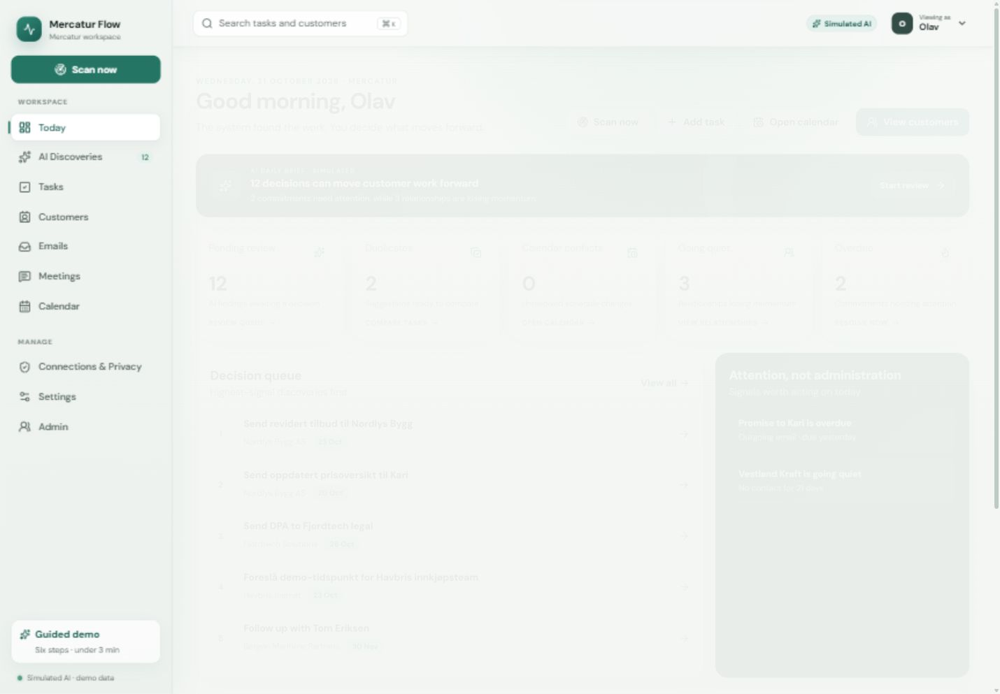

# Mercatur Flow

Mercatur Flow is a polished, clickable prototype for an AI-native CRM that discovers customer tasks from seeded emails and meeting transcripts. It demonstrates human review, source evidence, duplicate merging, calendar conflict resolution, role-specific workspaces, and browser-local demo persistence.



## Run locally

```bash
npm install
npm run dev
```

Open [http://localhost:3000](http://localhost:3000).

## Quality checks

```bash
npm run lint
npm test
npm run build
```

## Deploy to Vercel

This is a standard Next.js App Router project and requires no custom Vercel configuration.

1. Import this GitHub repository in Vercel.
2. Keep the detected framework preset as **Next.js**.
3. Keep the repository root as the project root.
4. Deploy using the default install and build settings.

The prototype has no required environment variables, backend services, database, OAuth credentials, or external integrations. All data and AI behavior are simulated, and user decisions persist only in the browser's local storage.
